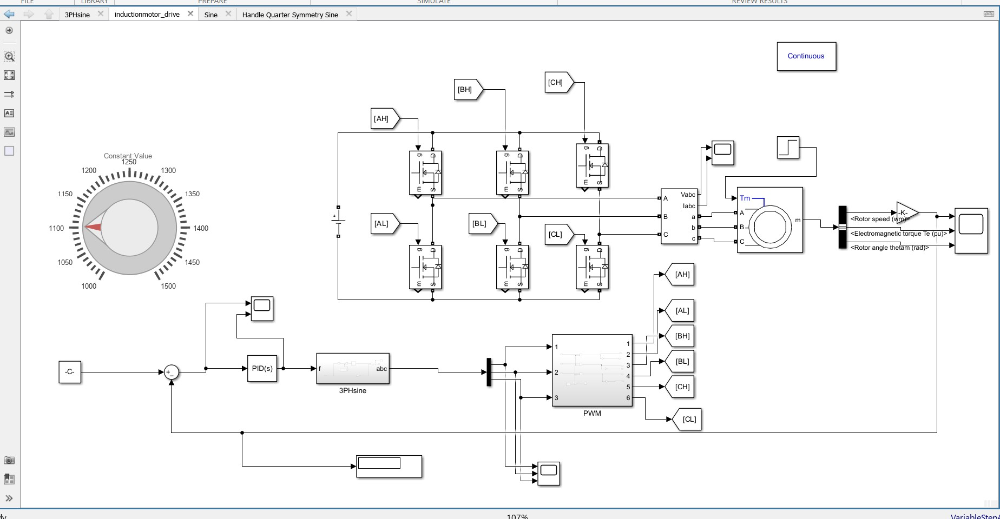
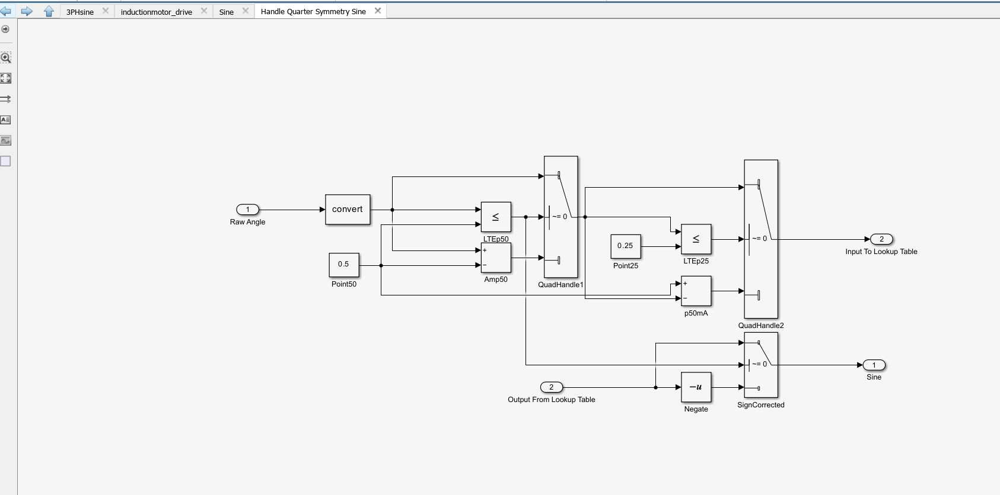
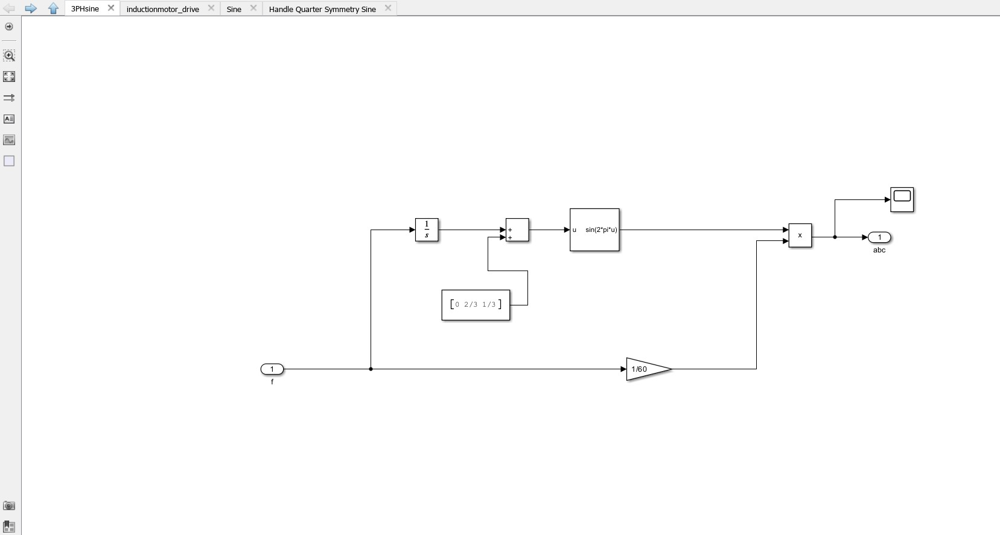
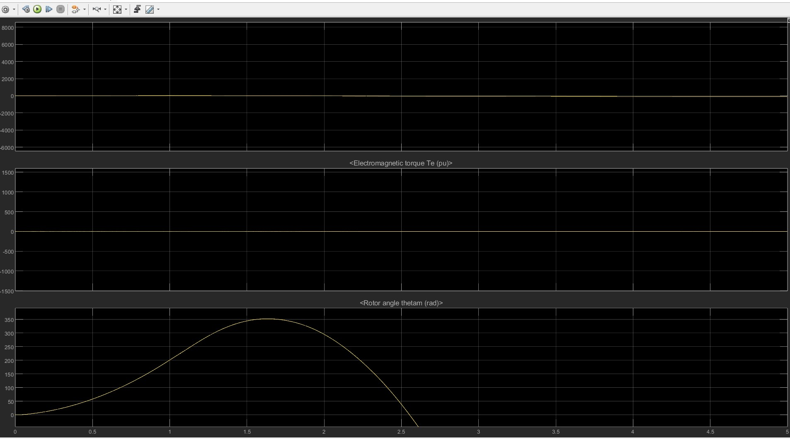

# V/f Speed Control of a Three-Phase Induction Motor Using MATLAB/Simulink

## Overview
This project focuses on the modelling and simulation of a three-phase induction motor drive using the Variable Voltage–Variable Frequency (V/f) control technique in MATLAB/Simulink.

The model uses power electronic switching, PWM-based inverter control, and a three-phase signal generation subsystem to study motor operation under different speed commands.

## Objectives
- To develop a MATLAB/Simulink model of a three-phase induction motor drive.
- To understand speed control using the V/f principle.
- To generate switching signals for inverter operation using PWM.
- To study the relationship between supply frequency, voltage, and motor speed.
- To analyse the behaviour of the motor drive through simulation.

## System Components
- Three-phase induction motor
- Power electronic inverter using switching devices
- PWM signal generation subsystem
- V/f control subsystem
- Three-phase reference signal generation
- Lookup tables and signal processing blocks
- Measurement and monitoring blocks

## Working Principle

### 1. V/f Control
The V/f control technique maintains an approximately constant ratio between the supply voltage and frequency to preserve the motor's magnetic flux over its normal operating range.

Since the synchronous speed of an induction motor depends on supply frequency, varying the frequency allows the motor speed to be controlled.

### 2. Three-Phase Signal Generation
The model includes subsystems for generating three-phase reference signals with appropriate phase displacement. These signals are used by the control system to establish the required inverter output frequency and phase sequence.

### 3. PWM and Inverter Operation
The PWM subsystem generates switching signals for the inverter. The inverter converts the DC input into a controlled three-phase AC supply for the induction motor.

### 4. Motor Operation and Analysis
The induction motor responds to changes in the inverter's output voltage and frequency. Simulation measurements can be used to examine motor speed, current, torque, and other electrical quantities.

## Software and Tools
- MATLAB
- Simulink
- Simscape Electrical / Specialized Power Systems (as applicable)

## Key Learning Outcomes
- Induction motor speed control
- V/f control principles
- PWM-based inverter switching
- Three-phase signal generation
- Power electronics and motor-drive modelling
- MATLAB/Simulink simulation and analysis

## Conclusion
This project provides practical understanding of variable-frequency induction motor drives and the role of inverter-based control in industrial motor applications. It demonstrates the use of MATLAB/Simulink for modelling and studying electrical drive systems.

## Project Files
The repository contains the Simulink model, subsystem screenshots, and relevant simulation diagrams.

## Simulation Model and Subsystems

### Complete Simulink Model

### Lookup Table Subsystem

### Signal Generation Subsystem

### PWM Subsystem

### Result

